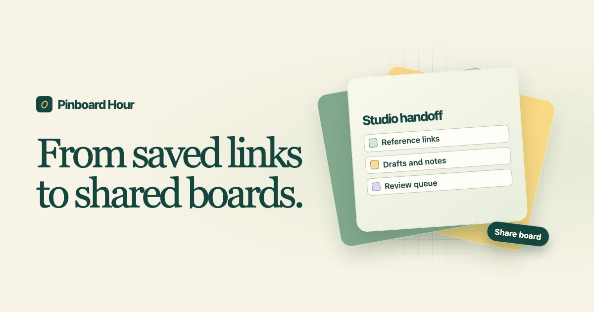

# OG Image Design System

Build a family of link-preview cards using your site's brand tokens and existing metadata routes. Decide which text and art change per page, then check the same layout with both long copy and missing artwork.

```bash
npx skills add steven-van-opus/creators-toolbox-skills --skill og-image-design-system
```

Try “Use og-image-design-system to set up matching OG images for our product and changelog. Use the fonts and colors already in the repository and check the result at 400 px.”



The [example HTML](examples/pinboard-hour.html) uses a fictional brand. It runs as a single local file with no JavaScript, web fonts, requests, or build step. From this folder, use a Chrome or Chromium executable to capture it.

```bash
chromium --headless --window-size=1200,630 --force-device-scale-factor=1 \
  --screenshot=pinboard-hour.png "file://$PWD/examples/pinboard-hour.html"
```

See the [Creators Toolbox guide](https://creatorstoolbox.com/@steven/post/g_agentic-social-post-design-skills) for the full workflow.

Inspired by [Posts' OG image skill](https://github.com/posts-design/mcp/tree/main/skills/og-image). These instructions, the fictional brand, and the example are original and [MIT licensed](../LICENSE).
